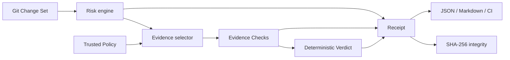

<div align="center">

# DiffLedger

**Make every code change show its receipts.**

Deterministic risk signals, executable evidence gates, and tamper-evident
receipts for human- and AI-authored code changes.

[Quick start](#quick-start) · [How it works](#how-it-works) · [Policy](#policy) · [Security](#security-model) · [中文](./README.zh-CN.md)

</div>

## Why DiffLedger?

Coding agents can produce a convincing diff in minutes. Reviewers are left to
answer harder questions:

- What exactly changed, including uncommitted and untracked files?
- Which parts of the change deserve extra scrutiny?
- Which checks actually ran, and which claims have no evidence?
- Is the report I am reading the same one CI produced?

AI reviewers generate more opinions. DiffLedger builds a deterministic evidence
gate underneath them. It works locally, without an account, API key, model, or
network connection.

```text
$ diffledger check --base main
DiffLedger PASS
Change Set  12 files, +438/-71
Risk        45/100 (medium)
Evidence    2/2 passed
Receipt     sha256:4b7ac0eac738d60e...
```

## Quick start

Node.js 20+ and Git are required.

```bash
npm install
npm run build
node dist/cli.js init

# Review .diffledger.json before running its commands.
node dist/cli.js check --base HEAD --markdown diffledger.receipt.md
node dist/cli.js verify diffledger.receipt.json
```

During local development, `--base HEAD` includes staged, unstaged, and untracked
files. In CI, compare committed revisions:

```bash
diffledger check --base origin/main --head HEAD
```

The package is ready for `npm install -g diffledger` after its first registry
release; until then the repository-local command above is the supported path.

## How it works



1. **Inspect** — compare a base revision with a committed target or the working
   tree using argument-safe Git invocations.
2. **Classify** — map paths into source, test, dependency, migration, workflow,
   security, configuration, and documentation categories.
3. **Assess** — emit transparent Risk Signals such as
   `workflow_change`, `migration_change`, or `source_without_tests`.
4. **Collect** — select Policy-defined Evidence Checks and execute them directly,
   without a shell.
5. **Decide** — fail when required evidence is missing/failed/timed out, or when
   the risk score exceeds the Policy threshold.
6. **Seal** — write a versioned Receipt and calculate a canonical SHA-256 digest.

## Policy

`diffledger init` detects common npm scripts and writes `.diffledger.json`:

```json
{
  "schemaVersion": 1,
  "maxRiskScore": 70,
  "maxOutputBytes": 16384,
  "checks": [
    {
      "id": "tests",
      "command": "npm",
      "args": ["test"],
      "when": ["source", "test"],
      "required": true,
      "timeoutMs": 300000
    }
  ]
}
```

`when` accepts `always`, `source`, `test`, `documentation`, `dependency`,
`migration`, `workflow`, `security`, and `configuration`. A check is selected
when at least one category matches.

Commands and arguments are separate by design. DiffLedger never joins them into
a shell string, making the executable behavior visible in code review.

## Receipt

A Receipt binds together:

- base commit and target/worktree digest;
- changed files, line counts, and categories;
- Policy digest and maximum accepted risk;
- stable Risk Signal codes and explanations;
- Evidence Result status, duration, bounded output, and exit code;
- PASS/FAIL Verdict and exact reasons;
- canonical SHA-256 Receipt Digest.

`diffledger verify` recalculates the digest without executing repository code.
Changing even the Verdict from PASS to FAIL invalidates the Receipt.

## CLI

```text
diffledger init [--force]
diffledger check [--base <ref>] [--head <ref>] [--config <path>]
                 [--output <path>] [--markdown <path>]
                 [--format console|json|markdown] [--no-run]
diffledger verify [receipt.json]
```

Exit codes:

| Code | Meaning |
| ---: | --- |
| 0 | Policy satisfied / Receipt valid |
| 1 | Verdict failed / Receipt invalid |
| 2 | Invalid command, Policy, Git state, or runtime setup |

## What makes this different?

| Tool category | Primary output | DiffLedger relationship |
| --- | --- | --- |
| AI PR reviewers | Probabilistic findings and suggestions | Can consume a Receipt, but cannot replace its deterministic facts |
| Linters / scanners | Tool-specific diagnostics | Can run as Evidence Checks |
| CI systems | Jobs and logs | Run DiffLedger and store its portable Receipt |
| Bug reproduction tools | Fail-before/pass-after proof | Excellent evidence for bug fixes; DiffLedger also covers features, migrations, dependencies, and workflows |
| Artifact attestations | Build provenance and identity | Future export target; a Receipt currently makes no identity claim |

## Security model

> **A DiffLedger Policy is executable code. Review it before running checks.**

- Evidence Checks run with the current user's permissions.
- Commands use direct process execution with `shell: false`.
- Stdout and stderr are bounded by Policy.
- Receipt integrity detects modification; it is **not** a signature, identity
  guarantee, sandbox, or remote attestation.
- The MVP trusts the checked-out Policy. Loading Policy from a protected base
  revision and Docker isolation are planned before untrusted public-PR use.

See [SECURITY.md](./SECURITY.md) for the threat model and disclosure process.

## Engineering notes

- Strict TypeScript, Node.js 20+, zero production dependencies.
- Real CLI integration tests create temporary Git repositories; no network mocks.
- CI matrix covers Node 20/22/24 on Linux, macOS, and Windows.
- Domain language lives in [CONTEXT.md](./CONTEXT.md).
- Product decisions and validation are recorded in [the PRD](./docs/PRD.md),
  [market research](./docs/research/market-research.md), and
  [the PRD review](./docs/reviews/prd-review.md).

## Roadmap

- v0.1: local CLI, risk signals, Evidence Checks, Receipt, offline verify
- v0.2: protected-base Policy loading, Docker runner, GitHub Check summary
- v0.3: in-toto predicate export, signatures, SARIF/coverage evidence adapters
- v0.4: local Web report and cross-PR evidence history

Contributions are welcome. Start with [CONTRIBUTING.md](./CONTRIBUTING.md).

## License

MIT

